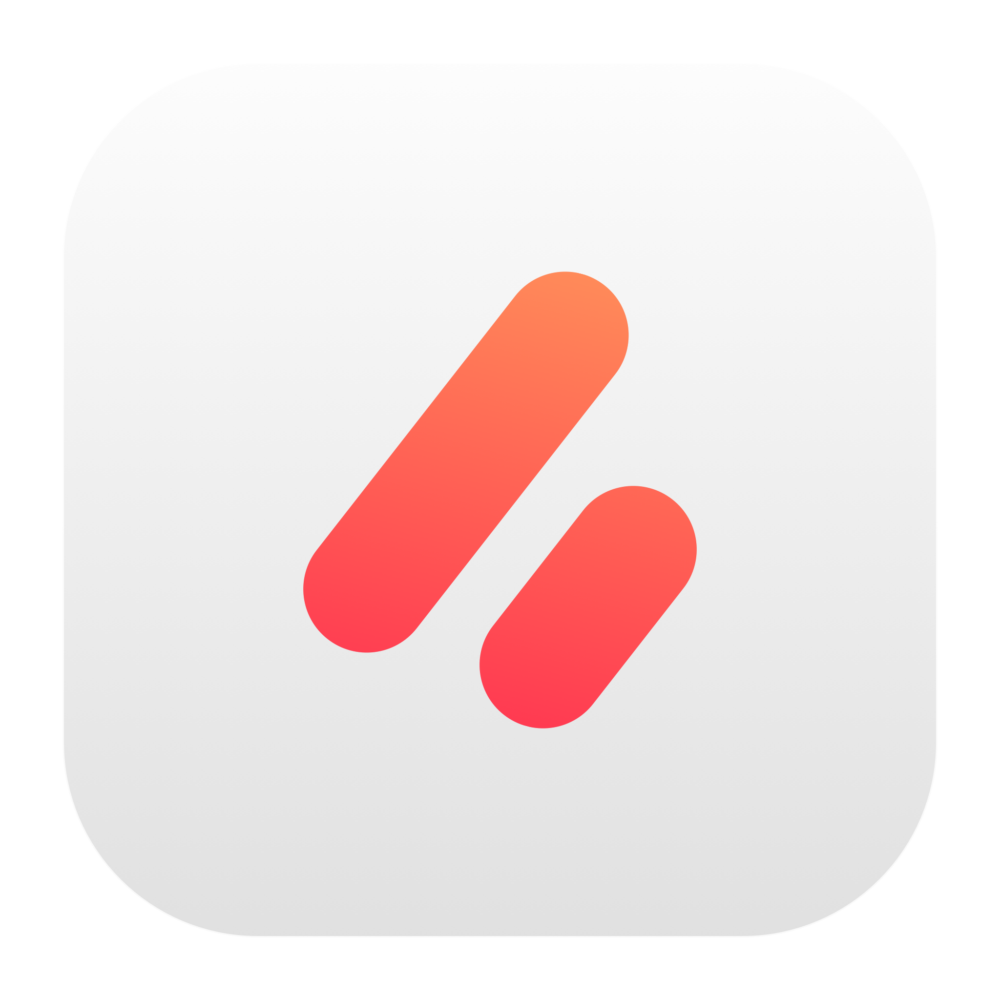
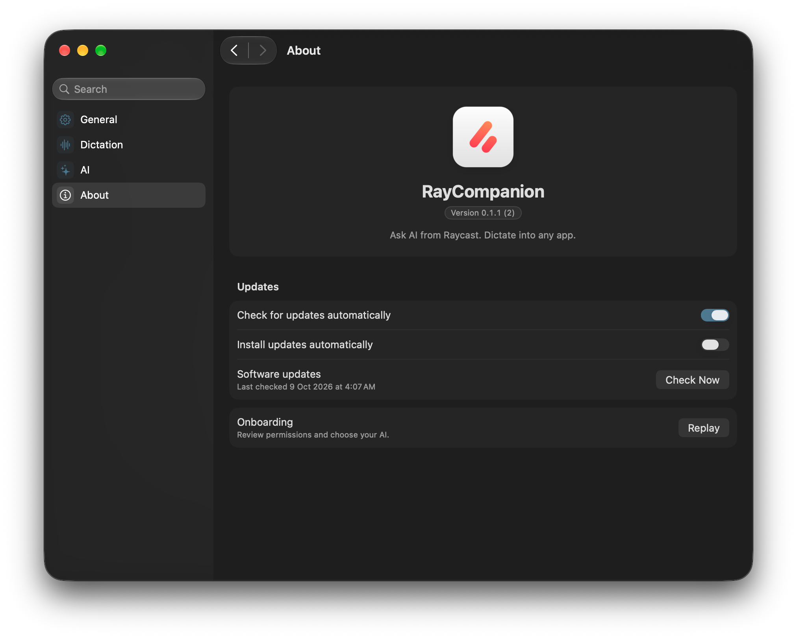

<p align="center"></p>
<h1 align="center">RayCompanion</h1>
<p align="center"><b>Ask AI from Raycast. Dictate into any app.</b></p>
<p align="center">
  
  <a href="https://github.com/techwithanirudh/raycompanion/actions/workflows/ci.yml"></a>
  
</p>
<p align="center"><a href="#features">Features</a> · <a href="#setup">Setup</a> · <a href="#shortcuts">Shortcuts</a> · <a href="#build">Build</a> · <a href="#resources">Resources</a></p>
<p align="center"></p>

## Features

- **Chat from Raycast.** Press Tab to bring your question into chat. Escape returns to Raycast. Open the app for the full chat window.
- **Choose your AI.** Use Apple Intelligence, supported installed AI apps, API providers or MCP tools. API keys stay in Keychain.
- **Use tools.** Calculate, search allowed folders, read text files and use selected text. Import installed Raycast AI extensions; compatibility varies and logins are separate.
- **Dictate locally.** Choose a microphone, shortcut and speech model, then dictate into other apps.
- **Keep your conversations.** Search history, switch models, attach files, and read Markdown and math. The last chat stays open by default, or choose Temporary Chat. Click an attached image to zoom in.

RayCompanion is a separate app, not a Raycast extension or an official Raycast product. Chat requests go directly to the provider you choose. Apple Intelligence and local dictation use their on-device routes.

## Setup

[Download RayCompanion](https://github.com/techwithanirudh/raycompanion/releases/latest/download/RayCompanion.zip), unzip it, and move the app into Applications. Requires macOS 26 and Apple silicon. The current release is self-signed and not notarized; macOS may require approval under Privacy & Security on first launch.

1. Open RayCompanion and follow setup.
2. Choose Apple Intelligence, an installed AI app, or an API provider.
3. Open Raycast, type your question, and press Tab.
4. To use dictation, enable it in Dictation settings, grant Microphone access, and download a speech model.

Press Tab with an empty Raycast search to reopen chat.

Choose your search provider in Settings → AI → Web search. Exa requires an API key.

## Shortcuts

| Shortcut | Action |
| --- | --- |
| Tab at Raycast root | Open inline chat |
| Escape | Return to Raycast or go back within a menu |
| ⌘K | Actions |
| ⌘Y | Chat history |
| ⌘J | Continue in the full chat window |
| ⌘N | New chat |
| ⌘⇧C | Copy the last response |
| ⌘, | Settings |
| ⌘W | Close the current window |

## Build

Use Swift 6 and the macOS 26 SDK. The project builds with SwiftPM; no Xcode project is required.

```sh
./scripts/check.sh
./scripts/build-app.sh
open build/RayCompanion.app
```

| Path | What lives there |
| --- | --- |
| `Sources/RayCompanion` | App lifecycle, menus, onboarding and Raycast integration |
| `Sources/TinycastKit` | Native AI, dictation, settings, Sparkle and shared upstream components |
| `Sources/ChatCore` | Root-search gating and inline-chat dismissal state |
| `Sources/DictationHelper` | Separate local speech worker |
| `Checks`, `Tests` | AI, provider, Markdown and core checks |


Release builds use `./scripts/release.sh`. The archive and appcast are signed with the release key in Keychain. GitHub Releases serves both; no API token ships in the app. See [release instructions](docs/RELEASING.md).

## Resources

- [Architecture](docs/ARCHITECTURE.md)
- [Releases](docs/RELEASING.md)
- [Tinycast integration](docs/TINYCAST.md)
- [Cleanup review](docs/CLEANUP.md)
- [Remotely reference](docs/REMOTELY.md)
- [Outstanding work](TODO.md)

## License

Based on [Tinycast](https://github.com/abue-ammar/tinycast), with adapted MIT onboarding components from [Remotely](https://github.com/techwithanirudh/remotely). The copied Tinycast source is AGPL-3.0. Upstream notices and asset terms remain in [docs/licenses](docs/licenses) and the app bundle. See [LICENSE](LICENSE).
